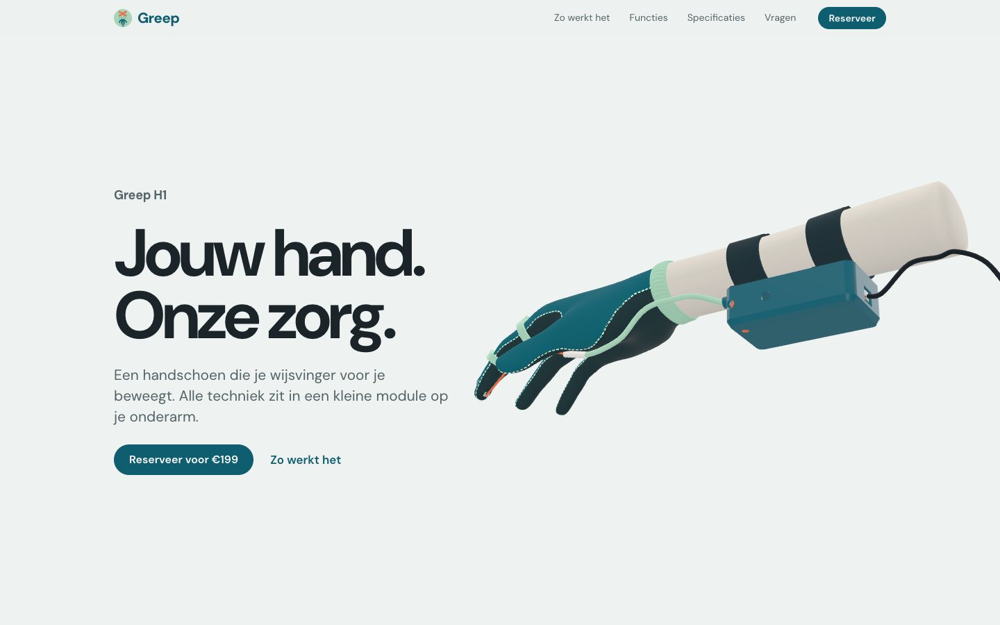

# The controlling wearable



Dark Tech project, semester 1 2026. Greep H1 is a provocatype: a glove that bends your index finger for you, pulled
by a string from a servo in a module on your forearm. This repository holds the project documentation and the Greep
product website, a Nuxt 4 site that sells the glove the way a real brand would and tells its story with a
scroll-driven 3D model.

## Stack

| | |
|---|---|
| Framework | Nuxt 4 (`srcDir` is `app/`), generated as a static site |
| 3D | three.js, with the glove loaded as a GLB |
| Type | DM Sans via Google Fonts |
| Tests | `node --test` |

## Getting started

```bash
npm install     # postinstall runs `nuxt prepare`
npm run dev     # http://localhost:5181
```

```bash
npm run generate   # static site -> .output/public
npm test           # tests for the scroll timeline
```

## The scroll story

The first screens scroll through one sticky 3D stage. Progress through that section runs from 0 to 1 and drives
everything: the captions, the camera, the module lid and the finger.

| Progress | Caption | What the model does |
|---|---|---|
| 0 – 0.11 | Hero | Whole glove beside the headline; the finger curls once on load |
| 0.17 – 0.39 | 1. De module | Camera moves to the forearm and the lid lifts |
| 0.43 – 0.60 | 2. Het touw | View of the palm, with the string through the straw and both rings |
| 0.64 – 0.89 | 3. De beweging | The finger bends with the scroll; live joint angles and string length |
| 0.93 – 1 | Beweging met vertrouwen. | Whole glove, centred |

The caption windows are `WINDOWS` in `app/components/GloveStory.vue`; the camera, lid and finger tracks sit at the
top of `app/lib/glove.js`. The camera holds still while a caption is fully visible and moves in the gaps, so change
both together. A critically damped spring sits between the scrollbar and the story so wheel steps glide. With
reduced motion on, the camera cuts between steps instead of flying.

## The model

`public/models/greep_A_handschoen.glb` is in millimetres: x points to the fingertips, y to the back of the hand and
z to the pinky side.

- **Finger**: bends by rotating `index-finger-phalanx-proximal`, `-intermediate` and `-distal` about their own
  bending axes.
- **String**: rebuilt on every pose through the empties `touw_punt_0` to `touw_punt_3`, with `touw_knik_1` to
  `touw_knik_3` as contact points at the joints. The readout's string length is how much shorter this path gets.
- **Lid**: `module_deksel` and `module_led` lift off together.

A replacement model works as long as it keeps these node names.

## Project structure

| Path | |
|---|---|
| `app/app.vue` | The page: nav, sections and footer |
| `app/components/GloveStory.vue` | Sticky 3D stage, captions and the scroll spring |
| `app/components/BuySection.vue` | Product still and the reserve button |
| `app/lib/glove.js` | three.js scene, finger rig and the story tracks |
| `app/lib/timeline.js` | Interpolation between track keys |
| `app/assets/css/main.css` | Design tokens and all styles |
| `public/` | Logo, glove model and its licence |
| `docs/`, `sprint-1/` | Standups, field testing and the sprint 1 retrospective |

## Credits

Hand model: WebXR generic-hand, © 2019 Amazon, MIT licence (`public/models/LICENSE-hand.txt`).
